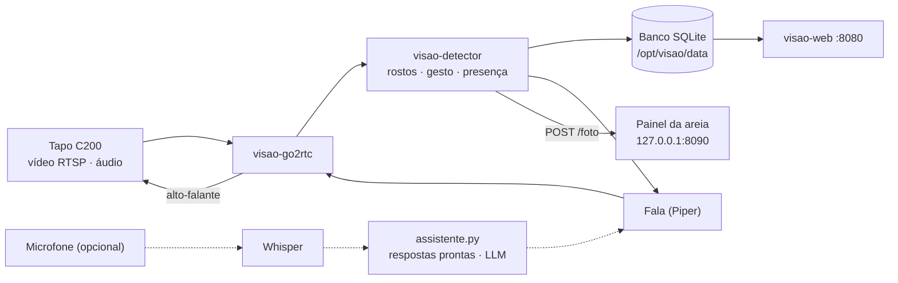

# Willbert-LAOB

> Assistente de visão e voz do Laboratório LAOB: reconhece os membros pela câmera, cumprimenta pelo nome, registra entradas e saídas e tira a foto da caixa de areia com um gesto.

   

## Sumário

- [Sobre](#sobre) · [Funcionalidades](#funcionalidades) · [Arquitetura](#arquitetura) · [Requisitos](#requisitos)
- [Instalação](#instalação) · [Uso](#uso) · [Configuração](#configuração) · [Testes](#testes)
- [Estrutura do projeto](#estrutura-do-projeto) · [Roadmap](#roadmap) · [Licença](#licença)

## Sobre

O Willbert é o sucessor do **Visão**, que nasceu no
[Mini-Server-LAOB](https://github.com/VituColombo0/Mini-Server-LAOB) (TV Box). Ele roda num PC,
observa o laboratório pela câmera Tapo C200, identifica quem chega e sai, fala pelo alto-falante
da câmera e conversa com a caixa de areia do
[Projetor-LAOB](https://github.com/VituColombo0/Projetor-LAOB). Tudo é local: sem nuvem.

> [!NOTE]
> **No laob (desde nov/2026) ele funciona sem IA e sem microfone:** só frases prontas (cumprimentos
> e a contagem da foto) e a foto da areia por gesto. O Ollama foi removido do laob
> (`remover-ollama.sh`). Conversa por voz e LLM continuam no código para PCs mais fortes.

## Funcionalidades

- **Reconhece** os membros (YuNet + SFace), várias pessoas ao mesmo tempo, com aprendizado contínuo e revisão.
- **Cumprimenta** uma vez por período (bom dia / boa tarde / boa noite), pelo nome, em dupla ou o grupo.
- **Anota as saídas:** quem some da câmera por mais de 30 min ganha uma "Saída" com a hora em que foi visto por último.
- **Foto por gesto:** duas mãos abertas ao lado do rosto por 1,5 s → "Foto em três… Sorria!" → foto recortada (sem fundo) projetada na areia.
- **Conversa** (quando ligada): chame "Willbert"; perguntas comuns (hora, data, quem está aqui, quem chegou, quem saiu, contas, piadas) têm resposta pronta em menos de 1 ms; o resto vai ao LLM local.
- **Comanda a areia por voz:** "coloca o tema vulcão", "liga a caça ao tesouro", "solta os peixes", "vamos fazer uma corrida de rios", "salve a vila", "vulcão em erupção", "outra rodada", "volta para a topografia".
- **Fala clara:** números, horas e datas por extenso, frases curtas; voz Piper "Faber" em cache.
- **Site** (:8080) com páginas Hoje, Ao vivo, Relatório, Membros e Revisão.
- **Escolhe o perfil de hardware sozinho** (com ou sem GPU, CPU antiga, TV Box).

## Arquitetura



**Perfis de hardware** (`visao/visao/hardware.py`; `visao-cli hardware` mostra o escolhido):

| Perfil | Quando | Reconhecimento | Whisper | LLM (Ollama) | Cumprimento |
|---|---|---|---|---|---|
| `gpu-forte` | NVIDIA 10+ GB | 1280 px, todo quadro | large-v3-turbo (GPU) | qwen3:8b | com contexto (LLM) |
| `gpu` | NVIDIA 6–10 GB | 1280 px, todo quadro | large-v3-turbo (GPU, int8) | qwen3:4b | com contexto (LLM) |
| `cpu-forte` | 8+ núcleos, 16+ GB | 1280 px, todo quadro | small (CPU, int8) | qwen3:4b | frase pronta |
| `cpu` | até 7 núcleos | 960 px, 1 a cada 2 | small (CPU, int8) | qwen3:1.7b | frase pronta |
| `cpu-basico` | sem AVX2 ou 4 núcleos | 960 px, 1 a cada 2 | base (CPU, int8) | qwen3:1.7b | frase pronta |
| `tvbox` | ARM com 1 GB | 576 px, 1 a cada 4 | — | — | frases geradas antes |

Placas NVIDIA com compute capability abaixo de 7.0 (como a GTX 750 Ti) não contam como GPU: o
faster-whisper atual não roda nelas.

## Requisitos

- PC Ubuntu/Debian x86_64 (testado num i5-3330, 4 núcleos, 15 GB, GTX 750 Ti).
- Câmera TP-Link Tapo C200 com **"Compatibilidade com terceiros"** ligada no app (para o áudio).
- Python 3.10+, FFmpeg (4.x ou 5.1+) e acesso `sudo` para a instalação.

**Desempenho medido no laob** (junto com o SARndbox):

| Etapa | Tempo |
|---|---|
| Detecção de rosto (YuNet 960 px) | ~50 ms por quadro |
| Identificação (SFace) | ~35 ms por rosto |
| Resposta pronta | < 1 ms |
| Voz (Piper Faber, frase curta) | ~1,4 s |
| Fala → texto (Whisper base) | ~2,5 s por frase |

## Instalação

1. Clone o repositório:

   ```bash
   git clone https://github.com/VituColombo0/Willbert-LAOB.git
   ```

2. Rode o instalador (driver NVIDIA se faltar, Whisper, Piper, go2rtc, serviços; o Ollama só nos perfis com LLM):

   ```bash
   cd Willbert-LAOB && sudo bash visao/deploy/install-pc.sh
   ```

3. Configure câmera, conta Tapo e senha do site (as senhas são digitadas escondidas):

   ```bash
   sudo bash visao/deploy/laob/configurar.sh
   ```

4. Cadastre os membros pelo site (`http://<IP-DO-PC>:8080`), com fotos ou pela câmera.

> [!IMPORTANT]
> Senhas (câmera, conta Tapo, site) ficam só em `/opt/visao/config.toml`, fora do git.
> Teste a câmera uma vez só: a Tapo bloqueia o acesso depois de várias falhas de login.

## Uso

**No laob** o Willbert fica desligado e só liga quando pedido:

```bash
willbert ligar
```

| Comando | O que faz |
| :--- | :--- |
| `willbert ligar` / `desligar` / `estado` | Liga, desliga ou mostra o estado |
| `sudo -n /usr/local/sbin/willbert-controle testar-camera` | Testa a câmera |
| `sudo -n /usr/local/sbin/willbert-controle foto` | Tira uma foto |
| `visao-cli hardware` | Mostra o perfil escolhido |
| `visao-cli conversar --mudo` | Conversa digitando (sem câmera) |

No laob, ligar e desligar também ficam no painel da caixa de areia (Projetor-LAOB, porta 8090);
a antiga pasta "6 - Willbert" da Área de Trabalho saiu em 13/11/2026.

**Scripts do laob** (`visao/deploy/laob/`, detalhes no [README da pasta](visao/deploy/laob/README.md)):

| Script | Para quê |
|---|---|
| `configurar.sh` | Câmera, conta Tapo e site, do zero |
| `atualizar-app.sh` | Atualiza o app instalado em `/opt/visao` |
| `otimizar.sh` / `desfazer.sh` | Desempenho do PC para SARndbox + Willbert (reversível) |
| `kernel-com-driver.sh` | Fixa o GRUB num kernel que tem o driver NVIDIA |
| `remover-ollama.sh` | Remove o Ollama |
| `instalar-atalhos.sh` | Comandos `willbert` e `willbert-janela` (e remove a antiga pasta 6) |

## Configuração

Arquivo `/opt/visao/config.toml` (modelo em [visao/config.example.toml](visao/config.example.toml)):

| Opção | Valor no laob | Descrição |
| :--- | :--- | :--- |
| `[hardware] profile` | `auto` (detecta `cpu-basico`) | Força outro perfil |
| `[assistant] usar_llm` | `false` | Usa ou não o LLM |
| `[gesture] keep_voice` | `false` | Mantém microfone e Whisper com o gesto ligado |
| `[presence] session_gap_min` | `30` | Minutos sem ver alguém para registrar a saída |

## Testes

Sem câmera, a partir da pasta `visao`:

```bash
python -m tests.test_conversa
```

```bash
python -m tests.sim_multi
```

```bash
python -m tests.test_foto
```

```bash
python -m tests.test_manutencao
```

Testam respostas prontas, LLM simulado, perfis e fala; várias pessoas, cumprimentos por período e
aprendizado; e o tratamento da foto do gesto. Passam quando terminam com `TUDO OK`.

## Estrutura do projeto

```text
Willbert-LAOB/
└── visao/
    ├── visao/
    │   ├── detector.py · tracker.py · faces.py · enroll.py   # reconhecimento
    │   ├── presence.py · reports.py · db.py                  # presença e relatórios
    │   ├── gesto.py · foto.py                                # gesto e foto da areia
    │   ├── assistente.py · fala.py · llm.py · ouvido.py      # conversa e voz
    │   ├── speaker.py · camera.py · notify.py                # câmera e alto-falante
    │   ├── hardware.py · config.py · cli.py                  # perfis, config, visao-cli
    │   └── web.py · templates/ · static/                     # site :8080
    ├── deploy/                  # install-pc.sh, serviços systemd, visao-cli
    │   └── laob/                # scripts e atalhos do PC do laboratório
    └── tests/                   # testes sem câmera
```

## Roadmap

- Trocar o SFace por ArcFace/InsightFace em PC com GPU (mais preciso de lado e de longe).
- Relatórios em linguagem natural ("resumo da semana").
- Backup diário do banco (`/opt/visao/data`).

## Equipe

Desenvolvido no **Laboratório LAOB**.

- Victor Colombo
- Prof. Mario Gazziro

## Licença

Distribuído sob a licença MIT. Veja [LICENSE](LICENSE).
